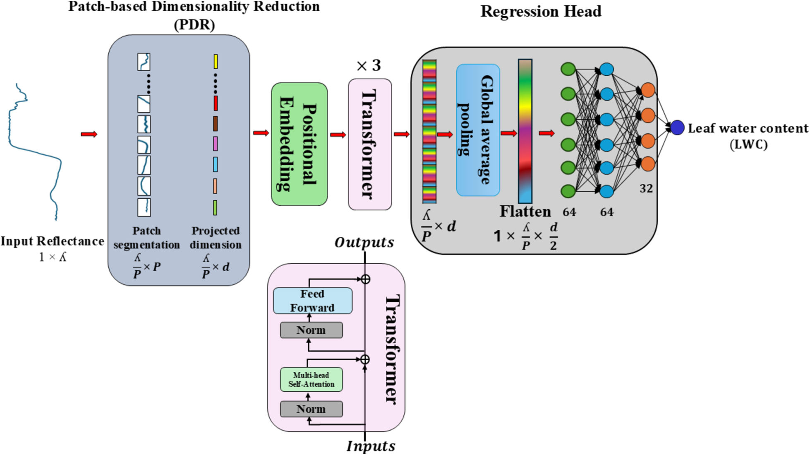

# LWC-former

Transformer that predicts leaf water content (LWC, measured as relative water content RWC) of blueberry plants from canopy hyperspectral reflectance.

Official code for:

> Rahman, M. H., Busby, S., Ru, S., Hanif, S., Sanz-Saez, A., Zheng, J., Rehman, T. U. (2025). **Transformer-based hyperspectral image analysis for phenotyping drought tolerance in blueberries.** *Computers and Electronics in Agriculture*, 228, 109684. [doi:10.1016/j.compag.2024.109684](https://doi.org/10.1016/j.compag.2024.109684)

This repository contains the preprocessing pipeline, model, training and prediction code with the paper's configuration. No data is included (see [Data](#data)).

## Architecture

LWC-former has four components: (1) a Patch-based Dimensionality Reduction (PDR) unit, (2) positional embedding, (3) transformer encoder layers and (4) a regression head.



*Fig. 6 of the paper. Λ is the number of spectral bands, P the patch size and d the embedding dimension.*

1. **PDR.** The preprocessed spectrum `X ∈ R^Λ` is segmented into `Λ/P` non-overlapping patches of `P` adjacent bands. Each patch `i` is projected to a `d`-dimensional token by its own linear map, `H_i = b_i + X_i W_i` with `W_i ∈ R^(P×d)`, `d < P` (Kaiming-uniform initialisation). This reduces the multicollinearity of neighbouring bands and produces a token sequence `H ∈ R^(Λ/P × d)`.
2. **Positional embedding.** Sinusoidal sine/cosine encoding of the patch position is added to each token.
3. **Transformer encoder × 3.** Each layer: multi-head self-attention `softmax(QKᵀ/√d)V` with residual connection and layer normalisation, then a two-layer feed-forward network with ReLU, residual connection and layer normalisation.
4. **Regression head.** The encoded tokens are pooled and flattened, then passed through an MLP with 64, 64 and 32 hidden units, each with batch normalisation, ReLU and dropout (40 %), and a final linear layer outputs LWC.

```
reflectance (1 x Λ) ─► log10(1/R), MSC, mean-centre
      ─► PDR: Λ/P patches of P bands, each ─► d-dim token (own W_i, b_i)
      ─► + positional embedding
      ─► Transformer encoder × 3 (self-attention, FFN, residual + LayerNorm)
      ─► pool / flatten
      ─► MLP 64 ─► 64 ─► 32 (BatchNorm, ReLU, dropout 0.4) ─► Linear ─► LWC
```

| hyperparameter | value (paper) |
|---|---|
| patch size P | 13 |
| embedding dimension d | 8 |
| encoder layers | 3 |
| attention heads | 2 |
| regression head | 64, 64, 32; dropout 0.4 |
| loss | MSE on standardised target |
| optimiser | Adam, weight decay 1e-3 |
| learning rate | triangular cyclic (1e-5 to 1e-3) |
| batch size | 32 |
| augmentation | random offset (6 % of band std) and slope (±5 %), 5 copies |

The paper selected this configuration by grid search over encoder layers (1–5), patch size (4–24), embedding dimension (2–18), attention heads (1–5) and head widths (16–128). The `pooling` key in the config chooses between `flatten` (default), `mean` (global average pooling) and `cls`.

### Training pipeline

1. Stratified 85:15 hold-out test split (by treatment and day), made before any balancing or augmentation.
2. Optional SMOTE-ENN balancing of the train-val set (`balance.enabled`; low vs high LWC at `balance.threshold`). The paper used it; set `balance.enabled: true` to follow the paper.
3. Offset/slope augmentation of the train-val spectra, 5 copies per spectrum (`augmentation.mode: static`, the paper's protocol; `online` jitters every mini-batch afresh instead).
4. 70:30 train/validation split (group-aware, so copies of one spectrum stay on one side).
5. log10(1/R) → MSC → mean-centring fitted on the training split only; target standardised with the training mean and std.
6. Mini-batch training with early stopping on validation RMSE; metrics are reported in original units.
7. Test and new spectra are preprocessed with the stored training statistics (`predict.py`).

## Installation

```bash
git clone https://github.com/hasiburniloy/lwc-former.git
cd lwc-former
pip install -e .
```

PyTorch may need a platform-specific install; see [pytorch.org](https://pytorch.org/get-started/locally/). Tested with Python 3.9–3.12 and PyTorch ≥ 2.0.

## Data

Data files are not part of this repository. Provide one table, one row per plant, `.xlsx` or `.csv`:

| Day | PlantID | Genotype | Treatment | RWC | 514 | 516 | … | 1000 |
|---|---|---|---|---|---|---|---|---|

- Reflectance columns: headers are wavelengths in nm, values in (0, 1]. They are detected automatically as the numeric-named columns; `data.spectral_columns` / `data.wavelength_range` in the config can restrict them.
- The target column is `RWC` (`data.target_columns`); metadata columns are anything else. `data.stratify_columns` (default `[Treatment, Day]`) must exist, or be set to `[]`.

A synthetic table with the right layout can be generated for a dry run:

```bash
python scripts/make_example_data.py --out example_data.csv
```

## Usage

Run from the repository root.

**Train**

```bash
python -m lwc_former.train --config lwc_former/config.yaml --data path/to/data.xlsx --out runs/lwc_former
```

Any config value can be overridden on the command line: `--set model.patch_size=10 --set model.embed_dim=6 --set balance.enabled=true`. Test sets are small, so `--repeat-splits 5` repeats the whole run on five different test splits and reports mean ± std.

Outputs per run (`runs/lwc_former/seed_<s>/`, or `split_<ss>/seed_<s>/` with several test splits): `model.pt` (weights and fitted preprocessing), `metrics.json` (train / val / test R² and RMSE, original units), `predictions_{train,val,test}.csv`, `metrics_test_by_Day.json`, `parity_plot.png`, `loss_curve.png`; `summary.json` aggregates all runs.

**Predict**

```bash
python -m lwc_former.predict --model runs/lwc_former/seed_42/model.pt --data new_spectra.xlsx --out predictions.csv
```

The new file needs the same spectral columns as training. The output has the non-spectral columns plus `RWC_predicted`; R² and RMSE are printed if `RWC` is present.

**Test**

```bash
pytest -q
```

## Configuration

All keys are documented in [`lwc_former/config.yaml`](lwc_former/config.yaml):

| group | keys |
|---|---|
| `data` | path, filter, spectral_columns, wavelength_range, target_columns, stratify_columns, test_size, split_seed |
| `balance` | enabled (SMOTE-ENN of train-val), target, threshold |
| `augmentation` | enabled, mode static/online, n_copies, include_original, offset_percent, slope_variation |
| `split` | val_size, group_aware |
| `model` | patch_size, embed_dim, n_layers, n_heads, ff_dim, attn_dropout, head_hidden, head_dropout, pooling flatten/mean/cls, use_cls, tail drop/pad |
| `training` | batch_size, optimizer adam/adamw, weight_decay, loss mse/huber, scheduler cyclic/onecycle/cosine/none, base_lr, max_lr, step_size_up, grad_clip, epochs, early_stopping_patience |
| `seeds`, `output_dir` | training seeds; output folder |

## Repository layout

```
lwc_former/
  common/         shared pipeline: io, preprocessing, augment, balance, split, dataset, metrics, utils
  model.py        LWCFormer (PDR, positional embedding, encoder, regression head)
  train.py        training / evaluation CLI
  predict.py      prediction CLI for new spectra
  config.yaml     paper configuration
scripts/make_example_data.py   synthetic table for a dry run
tests/            smoke tests on synthetic data
docs/             figures
```

## Citation

```bibtex
@article{rahman2025lwcformer,
  title   = {Transformer-based hyperspectral image analysis for phenotyping drought tolerance in blueberries},
  author  = {Rahman, Md. Hasibur and Busby, Savannah and Ru, Sushan and Hanif, Sajid and Sanz-Saez, Alvaro and Zheng, Jingyi and Rehman, Tanzeel U.},
  journal = {Computers and Electronics in Agriculture},
  volume  = {228},
  pages   = {109684},
  year    = {2025},
  doi     = {10.1016/j.compag.2024.109684}
}
```

## License

MIT, see [`LICENSE`](LICENSE).
